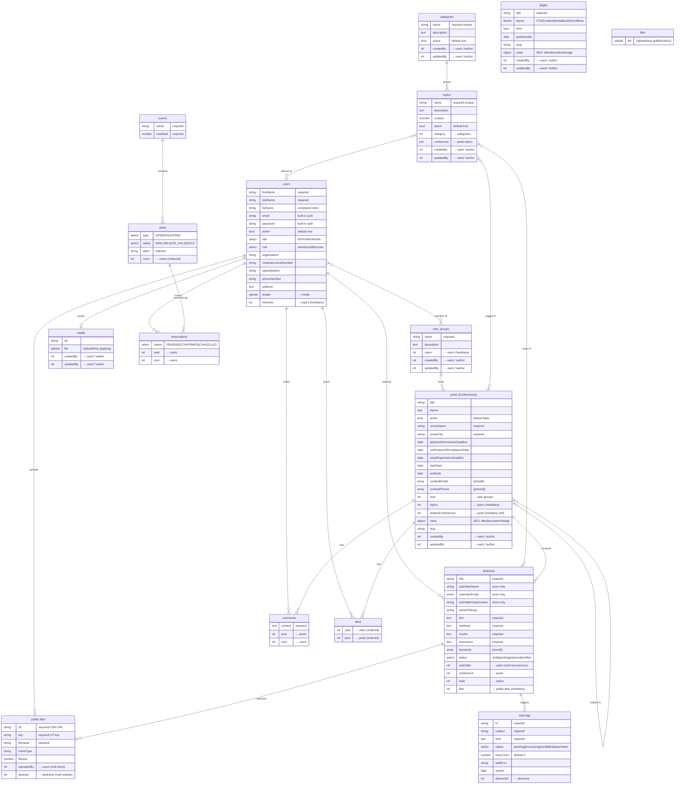

# Database Schema — Medical Conference (PayloadCMS)

> PayloadCMS automatically adds `id`, `createdAt`, and `updatedAt` to every collection (omitted below).
> Fields marked `*author` come from the shared `collectionAuthor` utility (`createdBy → users`, `updatedBy → users`).

## ER Diagram

## Collection Summary

| Collection       | Slug           | Purpose                     | Key Relations                              |
| ---------------- | -------------- | --------------------------- | ------------------------------------------ |
| **Users**        | `users`        | Auth & profiles             | → media (avatar), → topics (interests)     |
| **UserGroups**   | `user-groups`  | Host organizations          | → users (members)                          |
| **Categories**   | `categories`   | Top-level taxonomy          | —                                          |
| **Topics**       | `topics`       | Sub-topics in a category    | → categories, ← posts, ← abstracts         |
| **Posts**        | `posts`        | Conference events           | → user-groups (host), → topics             |
| **Pages**        | `pages`        | Static CMS pages            | —                                          |
| **Abstracts**    | `abstracts`    | Abstract submissions        | → posts, → topics, → users, → public-files |
| **Media**        | `media`        | Images (jpg/png)            | —                                          |
| **Files**        | `files`        | Private docs (pdf/doc)      | —                                          |
| **PublicFiles**  | `public-files` | Client-uploaded attachments | → users, → abstracts                       |
| **Comments**     | `comments`     | Conference comments         | → posts, → users                           |
| **Likes**        | `likes`        | Conference likes            | → posts, → users                           |
| **Rooms**        | `rooms`        | Venue rooms                 | —                                          |
| **Seats**        | `seats`        | Seats in a room             | → rooms                                    |
| **Reservations** | `reservations` | Seat bookings               | → seats, → users                           |
| **MailLogs**     | `mail-logs`    | Email queue & audit         | → abstracts                                |
